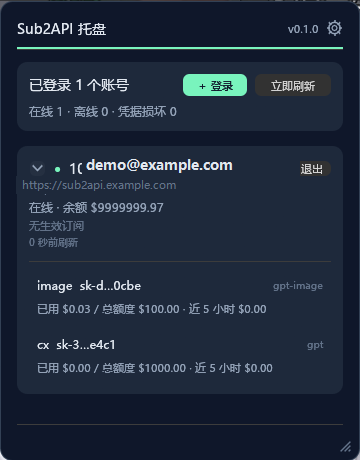
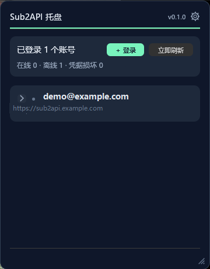

# 用量统计托盘

常驻 Windows 托盘 / macOS 菜单栏的小面板。无需打开浏览器，即可查看账号状态、余额、订阅用量和 API Key。

**当前版本：v0.4.3**



## 快速开始

* 从 [Releases](https://github.com/Kylineyes/sub2api_tray/releases) 下载 Windows x64 压缩包，解压后运行 `sub2api_tray.exe`。
* 源码运行需要 Rust 1.95+ 与 MSVC 工具链，执行 `cargo run`。
* 首次运行会在 exe 同目录创建 `app.json` 与 `accounts.json`。

## 能做什么

* **账号**：最多同时登录 10 个账号，支持 Sub2API 中转站与 DeepSeek 官方 API Key；展开查看明细，凭据失效可原地重新登录，也可登出并删除本地记录。
* **状态**：定时刷新在线状态与余额；Sub2API 账号同时读取订阅，DeepSeek 官方账号读取人民币余额并展示奖励/充值金额；多账号最多 4 个并行刷新。
* **API Key**：查看、复制、调额度、删除、新增；新增时可设置额度与有效期（按天数或通过日期选择器指定到时分），完整 Key 仅在创建时展示一次。
* **用量**：查看 24 小时 / 7 天 / 30 天 token 与花费曲线，支持全部 Key 或单个 Key。
* **界面**：日间 / 夜间主题、拖动缩放、钉住、设置、检查更新、单实例运行。
* **悬浮球**：右键托盘菜单或主面板总览卡片选择主账号/主 Key；常驻桌面并置顶，可拖拽且始终限制在屏幕内，仅在贴边时自动收起；设置页支持小/中/大三档尺寸；数据更新时气泡上浮淡出；左键打开面板，后台自动刷新余额/剩余额度。

## 托盘操作

| 操作 | 效果 |
| --- | --- |
| 左键单击托盘图标 | 显示 / 收起面板 |
| 右键单击托盘图标 | 立即刷新 / 悬浮球 / 版本 / 退出 |
| 标题左侧抓手或标题文字 | 拖动面板 |
| 面板四角 / 四边 | 拖动缩放 |
| 标题栏日月按钮 | 切换日间 / 夜间主题 |
| 标题栏图钉 | 钉住 / 取消钉住（控制点击面板外部时是否自动收起） |
| `Esc` | 关闭弹窗；无弹窗时收起面板 |

## 最近更新

* **v0.4.3**：新增 DeepSeek 官方 API Key 账号，支持余额刷新与专属展示；账号来源链接增加悬浮说明；
  设置页支持滚动并固定底部按钮；图钉按钮补充说明。
* **v0.4.2**：重新设计设置页并统一表单样式；设置保存改为后台执行，保存期间显示「正在保存设置」进度弹窗；
  Key 操作按钮未悬浮时不再占用高度，列表更紧凑。
* **v0.4.1**：新增 Key 支持有效期（天数或日期选择器指定到时分）；凭据损坏账号支持原地重新登录；
  DPAPI/钥匙串错误码写入日志；统一全局颜色、字号、按钮、间距与表单样式；修复危险按钮对比度和多处对齐问题。
* **v0.4.0**：新增 API Key 创建、删除、调额度与悬浮操作；用量汇总改为固定宽度流式布局；
  多账号状态与 Key 列表有界并行拉取；设置页打开加速，主题切换即时预览。

## 界面

| 收起（账号概览） | 展开（用量与 Key 明细） |
| --- | --- |
|  |  |

截图统一使用 [`testdata/demo`](testdata/demo/README.md) 的固定演示账号：

```text
demo@example.com
Demo Key A / Demo Key B
Demo Group
```

## 构建

```powershell
cargo run                 # 调试运行
cargo build --release     # 产物：target\release\sub2api_tray.exe
```

macOS 代码路径已实现，但尚未实机验收，暂不提供构建产物。

## 发布

在 `main` 打 `v*` tag 会触发 GitHub Actions，自动运行检查、构建 Windows x64 并挂到 Release。

```bash
git tag v0.4.3
git push origin v0.4.3
```

## 开发

分支、提交、注释与模块约定见 [AGENTS.md](AGENTS.md)。

## 许可证

[MIT](LICENSE)
